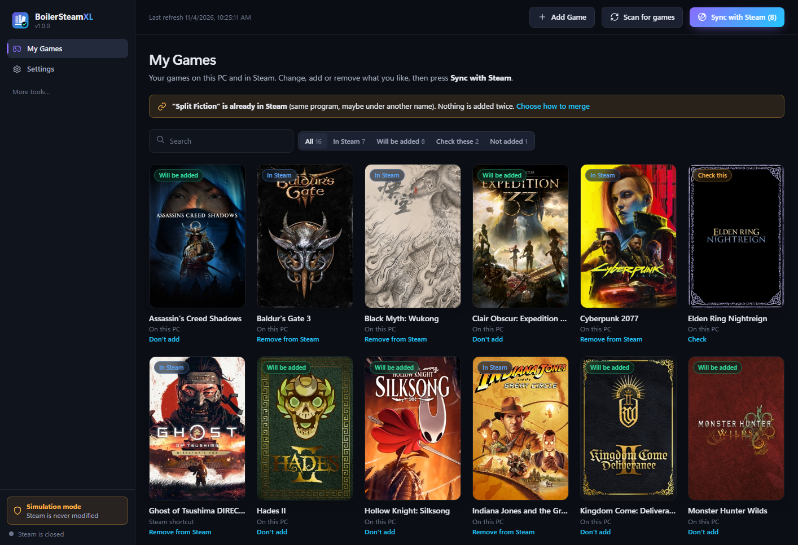
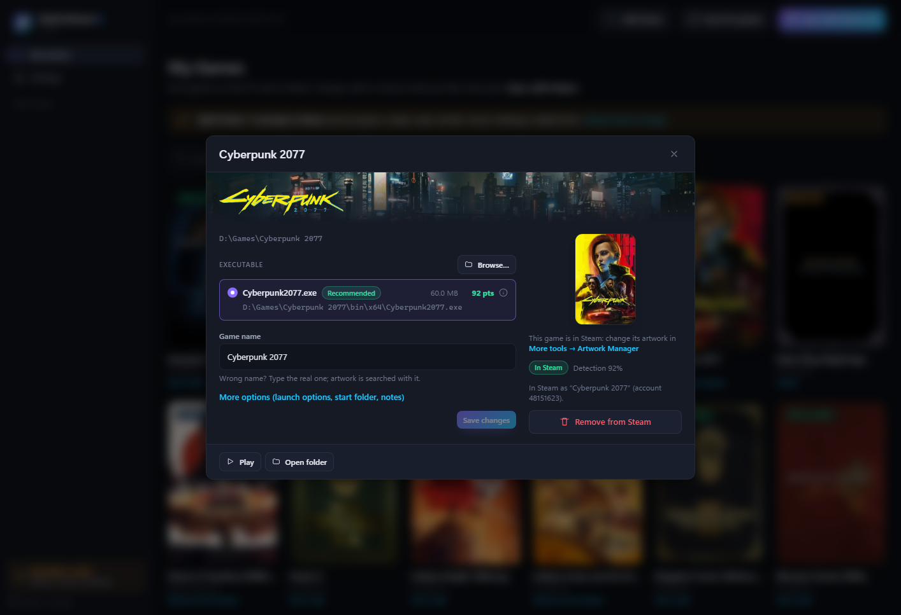
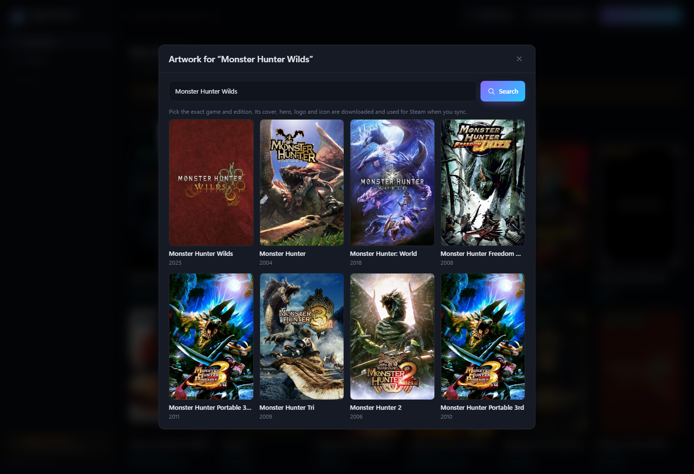
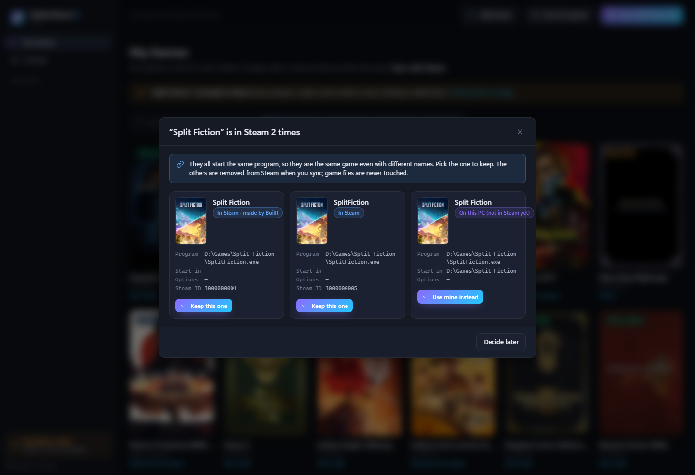
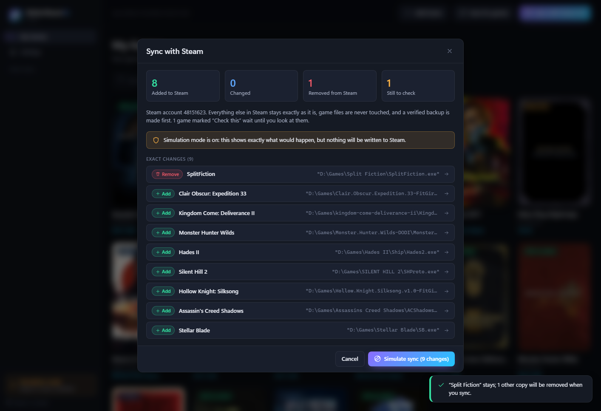

<p align="center">
  
</p>

<h1 align="center">BoilerSteamXL</h1>

<p align="center">
  <b>Your whole PC game collection in Steam. Every game, its real artwork, no duplicates.</b><br>
  Point it at <code>D:\Games</code>, check the list, press <b>Sync with Steam</b>. Done.
</p>

<p align="center">
  <a href="https://github.com/thedarkrain/BoilerSteamXL/releases/latest"></a>
  <a href="https://github.com/thedarkrain/BoilerSteamXL/releases"></a>
  
  <a href="https://github.com/thedarkrain/BoilerSteamXL/actions/workflows/boilersteamxl-windows.yml"></a>
  
</p>

<p align="center">
  <a href="https://github.com/thedarkrain/BoilerSteamXL/releases/latest"><b>⬇ Download for Windows</b></a>
  &nbsp;·&nbsp; <a href="#how-it-works">How it works</a>
  &nbsp;·&nbsp; <a href="#boilr-vs-boilersteamxl">BoilR vs BoilerSteamXL</a>
  &nbsp;·&nbsp; <a href="#benchmark">Benchmark</a>
</p>

> **A fork of [BoilR](https://github.com/PhilipK/BoilR)** by Philip Kristoffersen, built for one job:
> turning a folder full of standalone games and repacks into a clean Steam library. It keeps
> BoilR's Steam, SteamGridDB and launcher code, and adds a new engine for finding games in
> folders, a review step before anything is written, duplicate merging and a new interface.
> Not affiliated with Valve or the BoilR project. All credit for the foundation goes to BoilR.

<p align="center">
  
</p>

## Why

Steam only knows the games it installed. Everything else (repacks in `D:\Games`, DRM-free
installs, emulators, games from other stores) needs a non-Steam shortcut, added one by one,
with a grey icon and no artwork. Tools that do it in bulk tend to add installers, uninstallers
and redistributables as "games", get names like `Hollow.Knight.v1.5.78-FitGirl.Repack`, and add
the same game twice when it was already in Steam under another name.

BoilerSteamXL finds the real game in every folder, names it properly, shows you the result with
its cover, and only writes to Steam after you've seen exactly what will change.

## How it works

1. **Scan.** Pick your game folders. BoilerSteamXL looks through them (nothing is ever run),
   scores every `.exe`, skips installers, redistributables and tools, and names each game from
   its folder: `Hollow.Knight.v1.5.78-FitGirl.Repack` becomes **Hollow Knight**.
2. **Check.** **My Games** shows your games on this PC *and* the non-Steam shortcuts already in
   Steam, in one list with artwork. Fix a name, pick another `.exe`, merge duplicates, or mark
   what you don't want.
3. **Sync.** Press **Sync with Steam**. You see every change (added, renamed, removed) before
   anything happens. Steam is closed normally, a verified backup is made, the changes are
   written, and Steam starts again with your games and their artwork.

Rescans keep your decisions: you only see what is new.

| Game details: banner, logo, the chosen `.exe` and why | Pick the right cover from SteamGridDB |
| :---: | :---: |
|  |  |
| **A game is in Steam twice? Merge it** | **Sync with Steam: the exact changes first** |
|  |  |

<sub>Screenshots from the app's preview mode with sample games and real SteamGridDB artwork.</sub>

## Features

- 🎮 **One list, one button.** Every game on this PC and every non-Steam shortcut in Steam.
  Add, don't add, rename or remove, then **Sync with Steam**.
- 🖼️ **Artwork for every game.** Covers, wide capsules, heroes, logos and icons from
  [SteamGridDB](https://www.steamgriddb.com/), shown in the app *before* you import and copied
  into Steam when you do. Pick another match from a grid of covers. Without a key you still get
  each game's own icon, read from its `.exe`.
- 🔑 **Zero-setup key.** Already used BoilR? Your SteamGridDB key is picked up automatically.
  Otherwise, one click opens the key page and the copied key is saved by itself.
- 🧠 **Finds the right `.exe`.** Every candidate gets a score with the reasons shown
  ("+35 name matches the game folder", "-20 looks like a settings tool"). Close calls are marked
  *Check this* instead of guessed. See [docs/SCORING.md](docs/SCORING.md).
- 🏷️ **Real names.** Repack and scene tags (`FitGirl`, `DODI`, `ElAmigos`, `v1.5.78`,
  `MULTi13`) come off; collection folders like `D:\Games\PLUG&PLAY\…` are understood.
- 🧹 **No junk.** `_Redist`, `_CommonRedist`, DirectX, `vcredist`, `QuickSFV`, `unins000.exe`,
  `Language Selector.exe`, crash reporters, crack and NoDVD folders are skipped. The rules are
  editable, with an allowlist.
- 🚫 **No duplicates.** Two shortcuts that start the same program are the same game, whatever
  their names. A game already in Steam is never added again; one that is there twice opens a
  merge window showing each copy's path.
- ✏️ **Renames reach Steam.** Type the real name and the next sync renames the shortcut, even
  one made by BoilR or by hand, keeping its Steam ID, artwork and play time.
- 🛡️ **Safe by design.** Simulation mode is on until you turn it off. Every sync makes a verified
  backup first, writes atomically, keeps fields it doesn't know, never touches game files or
  saves, never overwrites a damaged `shortcuts.vdf`, and never force-closes Steam. One-click
  restore.
- 🧰 **More tools** for those who want them: Clean Rebuild (start your non-Steam library over,
  with rollback), the Artwork Manager for shortcuts already in Steam, exclusion rules,
  scheduled scans through Windows Task Scheduler (they never import), backups and history, and
  BoilR's launcher integrations (Epic, GOG, itch, EA, Ubisoft, Amazon, Playnite, Xbox).

## BoilR vs BoilerSteamXL

Every row was checked against the code of both: BoilR at the commit this fork started from,
BoilerSteamXL as released. **BoilR is the better choice if you are on Linux or a Steam Deck,
or mostly want launcher games**; BoilerSteamXL is for a Windows PC with a folder of games.

| | BoilR | BoilerSteamXL |
|---|---|---|
| **Platforms** | ✅ Windows, Linux, macOS, Steam Deck | Windows 10/11 only |
| **Flatpak / Flathub / AUR, Proton** | ✅ | ❌ |
| **Launcher integrations** | ✅ 15, including Heroic, Lutris, Bottles and others on Linux | The 8 Windows ones, from BoilR's code; off by default |
| **Steam collections per launcher** | ✅ (off by default) | ❌ |
| **Artwork for Steam's own games** | ✅ | ❌ (non-Steam shortcuts only) |
| **Finds games in plain folders** | ✅ "Standalone" (opt-in) | ✅ the main feature |
| **How the `.exe` is chosen** | Its name must match a folder above it | Points for every candidate, with a confidence and an "uncertain" flag |
| **Why that `.exe`** | ❌ | ✅ every point shown |
| **Repack tags removed from names** | ❌ raw folder name | ✅ |
| **Junk filtering** | Fixed list of 17 name patterns | Editable rules (folder, path, name, glob, regex, category) + allowlist |
| **See artwork before importing** | ❌ downloaded after writing | ✅ |
| **Review before writing to Steam** | A checkbox per game, ticked by default | Clear-cut games are listed as "will be added"; unsure ones wait for you |
| **Preview of the exact changes** | Partial (count + removals, 2.0 beta) | ✅ every change, field by field; refused if anything changed since |
| **Same game already in Steam under another name** | Added again (its ID is name + exe) | ✅ recognised by path, never added twice |
| **Merge duplicates** | ❌ | ✅ |
| **Remove shortcuts** | Its own, automatically on every sync | Any shortcut, when you ask; never by the scheduled scan |
| **Rename in Steam** | Its own shortcuts | ✅ also shortcuts made by BoilR or by hand |
| **Simulation / dry run** | ❌ | ✅ on by default, plus `--dry-run` |
| **Backup before writing** | ✅ copy (a failed copy is only logged) | ✅ verified; nothing is written if it fails |
| **Atomic write, unknown fields kept** | ❌ rewritten in place; fields like `sortas` are lost | ✅ temp file + rename + read-back; untouched shortcuts stay byte for byte |
| **Steam running** | Writes anyway by default; optional shutdown, killed after 20 s | Closes Steam normally and reopens it; never kills it |
| **Scheduled scans** | ❌ | ✅ Task Scheduler (never imports) |
| **Installer / portable** | Single exe | ✅ NSIS installer and portable zip |
| **Automated tests** | 118 | 220 (102 inherited from BoilR, 111 in the new engine, 7 in the app) |

## Benchmark

Both scanners ran on the same synthetic folder of **44 games** built like real repacks:
repack names, `_Redist` folders, crack and NoDVD copies, launchers and settings tools next to
the game, Unreal and Unity layouts, exe names that don't match the folder (`hl2.exe`,
`bio4.exe`, `TESV.exe`), Unicode names and deep nesting. Each result was checked against the
right answer.

| | BoilR (Standalone scanner) | BoilerSteamXL |
|---|:---:|:---:|
| Games found with the right `.exe` | 21 / 44 | **44 / 44** |
| Missed games | 23 | **0** |
| Junk listed as a game | 1 | **0** |
| Correct names | 21 / 44 | **44 / 44** |
| Unsure picks marked for you to check | — | 12 |
| Scan time (median of 5) | **13 ms** | 35 ms |

BoilR's strict rule never picks a wrong `.exe`, but it skips any game whose `.exe` is named
differently from its folder, and every repack-named folder. BoilR is also about 2.5× faster;
both finish 44 games in well under a tenth of a second.

To be fair: the test folder was written by the BoilerSteamXL side, and the first run found three
mistakes in BoilerSteamXL (a mod editor picked for Skyrim, a game 7 folders deep missed, a
dotted name split up). They were fixed and tested before the run above; the first run scored
42 / 44. Launchers are not compared. Full method, every game and its trap, and how to run it
yourself: **[docs/BENCHMARK.md](docs/BENCHMARK.md)**.

```
cargo run --release -p compare -- --runs 5
```

## Download and install

| | |
|---|---|
| [**BoilerSteamXL-Setup-Win64.exe**](https://github.com/thedarkrain/BoilerSteamXL/releases/latest) | Installer: Start menu shortcut, uninstaller (removes the scheduled task, optionally your data) |
| [**BoilerSteamXL-Portable-Win64.zip**](https://github.com/thedarkrain/BoilerSteamXL/releases/latest) | Extract anywhere and run; your data stays next to the exe |

Needs Windows 10 or 11 (x64) and the WebView2 Runtime, which Windows 11 already has. The files
are not code-signed, so SmartScreen may warn on the first start: **More info → Run anyway**.
Checksums are in `SHA256SUMS.txt` on the release.

### First start

1. The setup screen finds Steam (the *installation* folder, usually
   `C:\Program Files (x86)\Steam`) and asks for your game folders, e.g. `D:\Games`.
2. **Scan for games** fills **My Games**.
3. Check the list: fix names, merge duplicates, mark games you don't want.
4. BoilerSteamXL starts in **Simulation mode**, so **Sync with Steam** first shows what it would
   do without touching Steam. Turn it off in **Settings → Safety** when you're ready, then sync.

For covers, heroes and logos, get a free key at
[steamgriddb.com/profile/preferences/api](https://www.steamgriddb.com/profile/preferences/api)
(a Steam login works) and copy it; BoilerSteamXL saves it by itself. If BoilR already had one,
there is nothing to do.

## FAQ

**Will it mess up my Steam library?** It only writes after you confirm the exact changes, makes a
verified backup first, and leaves every shortcut you didn't touch byte for byte as it was.
Simulation mode lets you try everything first. **More tools → Backups & History** restores any
backup.

**Does it run my games or installers to look at them?** No. It reads file names, sizes and the
`.exe`'s built-in description and icon. Nothing is executed.

**It picked the wrong `.exe` / name.** Open the game, choose another `.exe` or type the real name.
Your choice is kept on every rescan. Unsure picks are marked *Check this* so you see them.

**A game shows twice.** That's the merge notice: pick the copy to keep, and the others are
removed from Steam at the next sync.

**Linux or Steam Deck?** Use [BoilR](https://github.com/PhilipK/BoilR), which supports them
(Flathub, AUR). BoilerSteamXL is Windows only.

## Command line

```
BoilerSteamXL.exe --scan [--scheduled]  find games, update the list (never imports)
BoilerSteamXL.exe --sync                scan, then add games you confirmed that waited for Steam to close
BoilerSteamXL.exe --dry-run             show what syncing would do
BoilerSteamXL.exe --status              the list, last scan, schedule
```

## Build from source

Rust stable and Node.js 20.19+ or 22.12+. On Windows, either the MSVC toolchain (Visual Studio
Build Tools) or the GNU toolchain with MinGW-w64 on `PATH`. With MinGW, put the Cargo target
folder on a path without spaces (`set CARGO_TARGET_DIR=D:\bsxl-target`): `windres` can't handle
spaces.

```powershell
cargo test -p bsxl-engine                    # engine tests (synthetic fixtures, never your Steam)
cd apps\boilr-tauri
npm ci
npm run dev                                  # browser preview with sample data, no Rust needed
npx tauri build                              # release exe + installer
cd ..\..
powershell -File scripts\build-release.ps1   # tests + installer + portable zip + checksums
```

The preview shows real artwork when the dev server gets a SteamGridDB key:
`set BOILR_SGDB_KEY_FILE=C:\path\to\key.txt`, then open `http://127.0.0.1:1420/?showcase`.

## Documentation

- [docs/ARCHITECTURE.md](docs/ARCHITECTURE.md): how it is built, the write path, data files
- [docs/SCORING.md](docs/SCORING.md): executable scoring, names, duplicate evidence
- [docs/BENCHMARK.md](docs/BENCHMARK.md): the benchmark against BoilR
- [CHANGELOG.md](CHANGELOG.md) · [PROGRESS.md](PROGRESS.md)
- [docs/BoilR-Readme.md](docs/BoilR-Readme.md): the original BoilR README

## Credits and license

BoilerSteamXL stands on [BoilR](https://github.com/PhilipK/BoilR) by
[Philip Kristoffersen](https://github.com/PhilipK) and its contributors: the Steam shortcut and
SteamGridDB code, the launcher integrations and the original idea are theirs. Artwork comes from
the [SteamGridDB](https://www.steamgriddb.com/) community.

MIT OR Apache-2.0, like BoilR. See [NOTICE.md](NOTICE.md), [LICENSE-MIT.txt](LICENSE-MIT.txt)
and [LICENSE-APACHE.txt](LICENSE-APACHE.txt).
